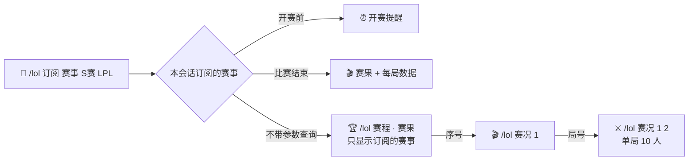
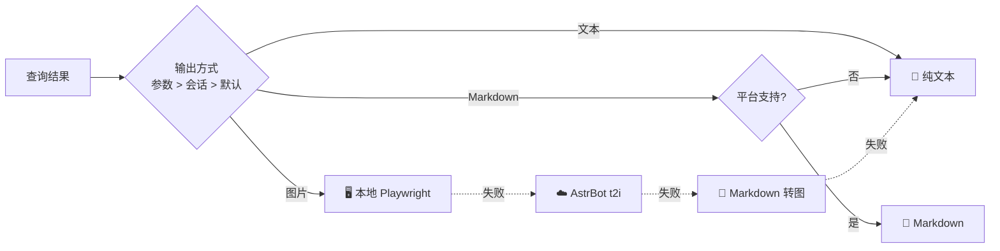
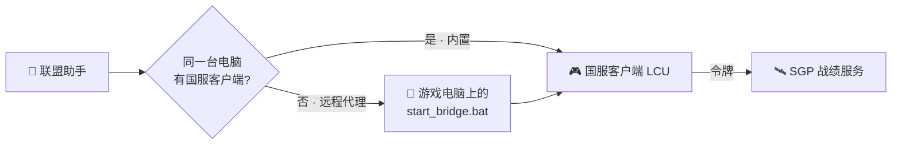

<div align="center">


# 联盟助手

**AstrBot 英雄联盟 / 云顶之弈数据插件**


📊 OP.GG 数据 · 🖼️ 三种推送 · 🇨🇳 国服战绩 · 🏆 赛事赛况 · 🔔 主动推送

</div>

---

## 🖼️ 效果预览

| 📜 战绩列表 | ⚔️ 单局详情 |
|:---:|:---:|
|  |  |
| **📈 版本梯队** | **♟️ 云顶阵容** |
|  |  |
| **🎬 赛况（每局数据）** | **🏆 赛程（多赛事）** |
|  |  |

## ✨ 功能

| | 英雄联盟 | | 云顶之弈 |
|:---:|---|:---:|---|
| 🛡️ | 英雄出装 · 符文 · 加点 · 克制 | ♟️ | 版本阵容 · 站位 · 运营过渡 |
| 🔮 | 海克斯大乱斗强化推荐（棱彩 / 黄金 / 白银） | | |
| 📈 | 分路梯队 · 胜率 / 登场 / 禁用 | 🗡️ | 英雄三件套（登顶率前三） |
| 📜 | 战绩列表（10 人 · 参团 · 标签） | 🎒 | 装备适配英雄 |
| ⚔️ | 单局详情（伤害 / 承伤条 · 出装） | 🔮 | 强化符文搜索 |
| 🏆 | 电竞赛程 · 赛果 · 积分榜（多赛事合并） | | |
| 🎬 | 赛况：每局阵容 · MVP · 资源 · 单局 10 人数据 | | |

## ⌨️ 指令

> 所有查询都可以追加 `-t` / `-m` / `-i`，分别以 文本 / Markdown / 图片 发送。

| 分类 | 指令 | 示例 |
|---|---|---|
| 🛡️ 英雄 | `/lol 英雄 <英雄> [位置] [模式]` | `/lol 英雄 快乐风男 中单` |
| 🔮 海克斯 | `/lol 海克斯 <英雄>` | `/lol 海克斯 亚索` |
| 📈 梯队 | `/lol 梯队 [位置]` | `/lol 梯队 打野` |
| 📜 战绩 | `/lol 战绩 [名字#标签] [大区]` | `/lol 战绩 Hide on bush#KR1 kr` |
| 🏅 资料 | `/lol 资料 [名字#标签] [大区]` | `/lol 资料 @某人` |
| ⚔️ 对局 | `/lol 对局 [序号]` | `/lol 对局 2` |
| 🏆 电竞 | `/lol 赛程 [联赛…]` · `赛果 [联赛…]` · `积分 <联赛>` | `/lol 赛程 S赛 LPL` |
| 🎬 赛况 | `/lol 赛况 [序号\|战队] [局号]` | `/lol 赛况 BLG 2` |
| ♟️ 云顶 | `/tft 阵容 [序号]` · `英雄` · `装备` · `强化` | `/tft 装备 大天使` |
| 🔗 绑定 | `/lol 绑定` · `绑定国服` · `账号` · `切换` · `解绑` | `/lol 绑定国服 名字#12345 艾欧尼亚` |
| 🔔 订阅 | `/lol 订阅 战绩 \| 赛事 [联赛…] \| 梯队 \| 云顶` | `/lol 订阅 赛事 S赛 LPL` |
| ⚙️ 设置 | `/lol 模式` · `大区` · `国服状态` · `状态` · `帮助` | `/lol 模式 图片` |

英雄支持中文名、称号、外号和英文名（亚索 / 疾风剑豪 / 快乐风男 / Yasuo）；赛事支持简称和中文（S赛 / 全球总决赛 / Worlds、季中赛 / MSI）。

## 🏆 赛事



| 场景 | 指令 | 效果 |
|---|---|---|
| 🔔 只订阅部分赛事 | `/lol 订阅 赛事 S赛 LPL` | 只推送这两个赛事的开赛提醒和赛果 |
| 🏆 合并查看 | `/lol 赛程 S赛 LPL` · `/lol 赛程 全部` | 多个赛事放进一张卡片 |
| 🎬 整场赛况 | `/lol 赛况 1` · `/lol 赛况 BLG` | 每局阵容、击杀、塔 / 龙 / 男爵 / 经济、MVP |
| ⚔️ 单局详情 | `/lol 赛况 BLG 2` | 双方 10 人符文、技能、出装、伤害承伤 |

每个赛事有自己的图标和主题色，卡片标题使用中文全称：

| 赛事 | 主题色 | 赛事 | 主题色 |
|---|---|---|---|
| 🌍 英雄联盟全球总决赛 | 🔵 蓝 | 🇨🇳 LPL 中国职业联赛 | 🔴 红 |
| 🇰🇷 LCK 韩国冠军联赛 | 🩵 青 | 🇪🇺 LEC 欧洲冠军联赛 | 🟢 蓝绿 |
| 🏅 季中冠军赛 | 🟡 金 | 🚩 先锋赛 | 🟠 橙 |
| 🌏 LCP 亚太冠军联赛 | 🩷 粉 | 🌎 LTA 美洲冠军联赛 | 🟠 橙黄 |

> 💡 赛果推送会等 OP.GG 发布每局数据后再发送，最多等待 40 分钟，超时则只推送比分。

## 🖨️ 推送方式



| 方式 | 适用 | 说明 |
|---|---|---|
| 📝 文本 | 所有平台 | 兜底方式，不会失败 |
| 📄 Markdown | Telegram · Discord · 飞书 · KOOK … | 列表见 `output.markdown_platforms` |
| 🖼️ 图片 | 所有平台 | 图标内嵌，装了 `playwright` 时本地渲染约 3 秒 |

## 🇨🇳 国服接入

OP.GG 不收录国服，插件通过登录着的国服客户端查询（参考 League Akari 的 LCU + SGP 方案）。



| 部署方式 | 需要做什么 |
|---|---|
| 🖥️ AstrBot 和国服客户端在同一台 Windows 电脑 | 什么都不用配，登录客户端即可 |
| ☁️ AstrBot 在服务器 / Docker / NAS | 游戏电脑双击 `bridge/start_bridge.bat`，把窗口显示的地址（含 `?token=`）填到「国服 → 远程国服代理」 |

然后 `/lol 国服状态` 检查连接，`/lol 绑定国服 名字#编号 艾欧尼亚` 绑定账号。

> 💡 大区支持名称、ID 和合并前的旧大区名（祖安 → 联盟一区）。战绩可跨区查询，段位仅限客户端所在大区。

## ⚙️ 配置

默认值开箱即用，WebUI 只显示常用的 17 项：

| 分组 | 配置项 |
|---|---|
| 🌐 网络 | 出站代理（国内访问 OP.GG 建议填写） |
| 🖼️ 输出 | 默认输出方式 · 图片主题 · 支持 Markdown 的平台 |
| 🔎 查询 | 外服默认大区 · 战绩默认场次 |
| 🇨🇳 国服 | 启用 · 默认大区 · 远程国服代理（可选） |
| 🏆 赛事 | 赛程默认赛事（未订阅的会话默认只看这些） |
| 🔔 推送 | 启用 · 新对局检查间隔 · 开赛提醒 · 赛果附带每局数据 · 日报时刻 · 仅管理员订阅 |
| 🏷️ 别名 | 英雄自定义别名 |

> 🔧 数据源地址、缓存时长、渲染细节等高级项已隐藏，需要时可在 `data/config/astrbot_plugin_lolhelper_config.json` 中修改。

<details>
<summary>📦 安装与开发</summary>

将仓库放到 `AstrBot/data/plugins/astrbot_plugin_lolhelper` 后在 WebUI 重载。依赖 `aiohttp`、`jinja2`（AstrBot 已自带），可选 `playwright` 加速出图。

```bash
python -m pytest tests            # 离线单元测试
python tests/smoke_live.py out    # 联网生成各视图的 txt / md / html
python tests/astrbot_harness.py w # 在真实 AstrBot 中回归全部指令
```

</details>

<details>
<summary>🗂️ 目录结构</summary>

```
main.py               AstrBot 入口：指令 · LLM 工具 · 消息发送
lolhelper/            核心包（不依赖 AstrBot）
  mcp_client.py dsl.py      OP.GG MCP 客户端与返回格式解析
  service.py tft.py game.py 查询与视图
  esports.py                赛事每局数据（esports.op.gg）
  cn.py                     国服代理客户端
  render/ doc.py            文本 / Markdown / HTML / 图片渲染
  facade.py push.py
templates/card.html   图片模板
bridge/               国服远程代理（零依赖，插件也直接内置调用）
```

</details>

## ⚠️ 已知限制

- 🚫 无限火力 / 极限闪击的英雄数据：OP.GG MCP 参数校验问题，暂不可用
- 🚫 云顶个人战绩：OP.GG MCP 未提供接口
- 🛡️ “护盾”标签仅国服数据有
- 🎬 赛况数据来自 esports.op.gg 网页接口（无公开文档），接口变动时自动退回只显示比分

---

<div align="center"><sub>数据来自 OP.GG · esports.op.gg · Data Dragon · CommunityDragon。本项目与 Riot Games、OP.GG 无关。</sub></div>

