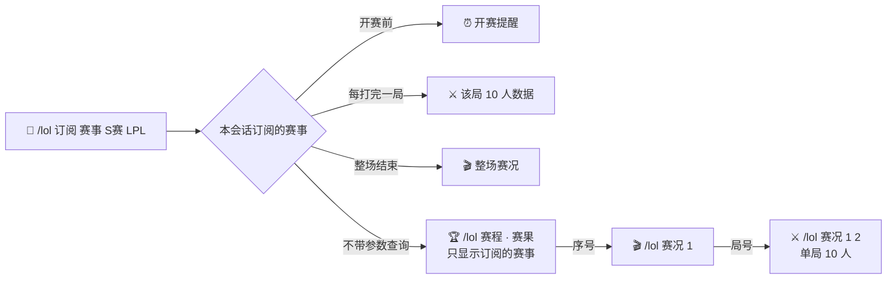
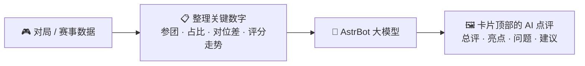
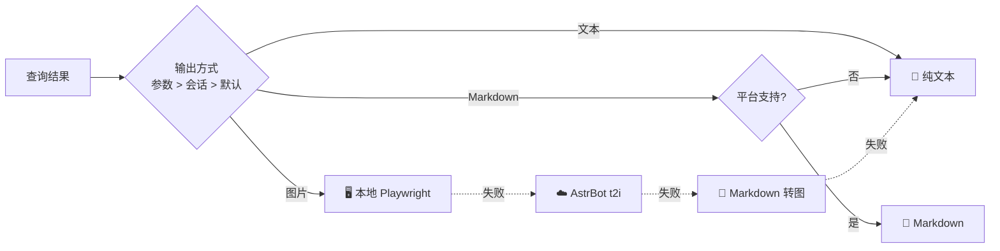
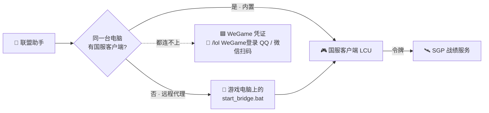

<div align="center">


# 联盟助手

**AstrBot 英雄联盟 / 云顶之弈数据插件**


📊 OP.GG 数据 · 🖼️ 三种推送 · 🇨🇳 国服战绩 · 🏆 赛事赛况 · 🤖 AI 点评 · 🎉 群玩法 · 🔔 主动推送

</div>

---

## 🖼️ 效果预览

| 📜 战绩列表 | ⚔️ 单局详情 |
|:---:|:---:|
|  |  |
| **🛡️ 英雄出装** | **📈 版本梯队** |
|  |  |
| **🤖 AI 近期诊断** | **🏅 群周榜 · AI 周报** |
|  |  |
| **⚖️ 群友 PK** | **🎲 赛事竞猜** |
|  |  |
| **🎬 赛况（每局数据）** | **📊 积分榜** |
|  |  |
| **♟️ 云顶强势阵容** | **🧩 云顶阵容详情** |
|  |  |

> 示例图中的群友昵称、群榜数据和 AI 点评文字为演示内容，其余为真实查询结果。

## ✨ 功能

| | 英雄联盟 | | 云顶之弈 |
|:---:|---|:---:|---|
| 🛡️ | 英雄出装 · 符文 · 加点 · 克制 | ♟️ | 版本阵容 · 站位 · 运营过渡 |
| 🔮 | 海克斯大乱斗强化推荐（棱彩 / 黄金 / 白银） | 🗡️ | 英雄三件套（登顶率前三） |
| 📈 | 分路梯队 · 胜率 / 登场 / 禁用 | 🎒 | 装备适配英雄 |
| 📜 | 战绩列表（10 人 · 参团 · 标签） | 🔮 | 强化符文搜索 |
| ⚔️ | 单局详情（伤害 / 承伤条 · 出装） | | |
| 🏆 | 电竞赛程 · 赛果 · 积分榜（多赛事合并） | | |
| 🎬 | 赛况：每局阵容 · MVP · 资源 · 单局 10 人数据 | | |
| 🇨🇳 | 国服战绩：本机客户端 · 远程代理 · WeGame 扫码登录 | | |

| | AI 点评 | | 群玩法 |
|:---:|---|:---:|---|
| ⚔️ | 单局点评：对位差值 · 版本出装与对线胜率参考 | 🏅 | 日榜 / 周榜 · 分项榜 · 称号 · 段位变动 |
| 📈 | 近期诊断：整体与最近 5 局对比 | 📣 | 群友播报：开黑 · 内战 · 五杀 · 连胜连败 |
| 🎬 | 比赛点评：单局逐分钟评分走势 · 整场总结 | ⚖️ | 群友 PK，AI 当裁判 |
| 🎙️ | 专业 / 幽默 / 锐评三种风格 | 🎲 | 赛事竞猜 · 猜英雄 · 今天玩什么 · 内战分队 |

## ⌨️ 指令

> 所有查询都可以追加 `-t` / `-m` / `-i`，分别以 文本 / Markdown / 图片 发送。

记不住指令时，只发 `/lol` 就会弹出帮助主菜单：

| 想做什么 | 发送 |
|---|---|
| 🧭 看主菜单 | `/lol` 或 `/lol 帮助`，再回复序号进入分类（60 秒内，回复 0 返回主菜单） |
| 📂 看某一类指令 | `/lol 帮助 赛事` · `/lol 帮助 3` · `/tft` |
| 📖 看单个指令的用法 | `/lol 帮助 竞猜`：用法、示例、别名和相关指令 |
| 🖼️ 图片版菜单 | `/lol 帮助 -i` |
| ⚡ 直接查询 | `/lol 亚索`（英雄）· `/lol Faker#KR1`（战绩）· `/lol BLG`（赛况）· `/lol LPL`（赛程）· `/lol 中单`（梯队）· `/tft 大天使` |

菜单按场景调整：私聊里不显示群玩法，关掉的功能和仅管理员可用的指令不显示，没绑定账号时第一行提示先绑定。打错指令会提示相近的指令（`/lol 战积` → `/lol 战绩`），缺少参数时显示用法和示例。在 QQ 官方机器人、Telegram、Discord、KOOK、飞书、Slack、钉钉和 AstrBot 网页聊天里，菜单还附带分类按钮（需要 AstrBot 4.29 及以上）；QQ 个人号（aiocqhttp）不支持按钮，回复序号即可。

| 分类 | 指令 | 示例 |
|---|---|---|
| 🛡️ 英雄 | `/lol 英雄 <英雄或梯队序号> [位置] [模式] [地区] [段位]` | `/lol 英雄 快乐风男 中单` · `/lol 英雄 3` |
| 🔮 海克斯 | `/lol 海克斯 <英雄>` | `/lol 海克斯 亚索` |
| 📈 梯队 | `/lol 梯队 [位置] [地区] [段位]` | `/lol 梯队 打野 韩服 钻石+` |
| 📜 战绩 | `/lol 战绩 [名字#标签] [大区]` | `/lol 战绩 Hide on bush#KR1 kr` |
| 🏅 资料 | `/lol 资料 [名字#标签] [大区]` | `/lol 资料 @某人` |
| ⚔️ 对局 | `/lol 对局 [序号] [名字#标签]` | `/lol 对局 2` |
| 🏆 电竞 | `/lol 赛程 [联赛…]` · `赛果 [联赛…]` · `积分 <联赛>` | `/lol 赛程 S赛 LPL` |
| 🎬 赛况 | `/lol 赛况 [序号\|战队] [局号]` | `/lol 赛况 BLG 2` |
| 🤖 点评 | `/lol 点评 [序号] [名字#标签]` · `诊断 [名字#标签] [局数]` · `赛况点评 [战队] [局号]` | `/lol 锐评` · `/lol 诊断 幽默` · `/lol 赛况点评 BLG 3` |
| 🎉 群玩法 | `/lol 榜单 [日\|周\|竞猜\|猜英雄]` · `对比 @群友` · `竞猜` · `猜英雄` · `今天玩什么` · `分队 @…` | `/lol 榜单 周 上周` · `/lol 竞猜 BLG 3:1` |
| 👥 群设置 | `/lol 群播报 开\|关` · `上榜` · `下榜` · `群成员` | `/lol 群播报 关` |
| ♟️ 云顶 | `/tft 阵容 [序号]` · `英雄` · `装备` · `强化` | `/tft 装备 大天使` |
| 🔗 绑定 | `/lol 绑定` · `绑定国服` · `账号` · `切换` · `解绑` | `/lol 绑定国服 名字#12345 艾欧尼亚` |
| 🔔 订阅 | `/lol 订阅 战绩 \| 赛事 [联赛…] \| 梯队 \| 云顶` · `订阅 列表` · `订阅 取消 <ID>` | `/lol 订阅 赛事 S赛 LPL` |
| ⚙️ 设置 | `/lol 模式` · `大区` · `国服状态` · `WeGame登录` · `状态` · `帮助 [分类\|指令\|全部]` | `/lol 模式 图片` · `/lol 帮助 竞猜` |

旧写法 `/lol 日榜`、`周榜`、`竞猜榜`、`猜英雄榜`、`订阅列表`、`退订` 继续可用。

英雄支持中文名、称号、外号和英文名（亚索 / 疾风剑豪 / 快乐风男 / Yasuo）；赛事支持简称和中文（S赛 / 全球总决赛 / Worlds、季中赛 / MSI）。

> 📊 梯队和英雄出装默认使用 **全球 · 翡翠+** 数据（插件配置「英雄数据」可改），卡片标题下标注数据地区和段位；查询时也可临时指定，如 `韩服` `全球` `钻石+` `大师+` `王者`。每张卡片底部的「试试」栏会给出下一步可用的指令。

## 🏆 赛事



| 场景 | 指令 | 效果 |
|---|---|---|
| 🔔 只订阅部分赛事 | `/lol 订阅 赛事 S赛 LPL` | 只推送这两个赛事的开赛提醒、每局数据和整场赛况 |
| 🏆 合并查看 | `/lol 赛程 S赛 LPL` · `/lol 赛程 全部` | 多个赛事放进一张卡片 |
| 🎬 整场赛况 | `/lol 赛况 1` · `/lol 赛况 BLG` | 每局阵容、击杀、塔 / 龙 / 男爵 / 经济、MVP |
| ⚔️ 单局详情 | `/lol 赛况 BLG 2` | 双方 10 人符文、技能、出装、伤害承伤 |
| 📊 积分榜 | `/lol 积分 LCK` | 每队一行，显示大场、小场和积分，前三名带色条 |

每个赛事有自己的图标和主题色，卡片标题使用中文全称：

| 赛事 | 主题色 | 赛事 | 主题色 |
|---|---|---|---|
| 🌍 英雄联盟全球总决赛 | 🔵 蓝 | 🏅 英雄联盟季中冠军赛 | 🟡 金 |
| 🚩 英雄联盟先锋赛 | 🟠 橙 | 🎮 电竞世界杯 | 🟢 绿 |
| 🇨🇳 LPL 中国职业联赛 | 🔴 红 | 🇰🇷 LCK 韩国冠军联赛 | 🩵 青 |
| 🇪🇺 LEC 欧洲冠军联赛 | 🟢 蓝绿 | 🇺🇸 LCS 北美冠军联赛 | 🟣 蓝紫 |
| 🌏 LCP 亚太冠军联赛 | 🩷 粉 | 🌎 LTA 美洲冠军联赛（南 / 北区） | 🟠 橙黄 |
| 🇧🇷 CBLOL 巴西联赛 | 🟢 黄绿 | 🇻🇳 VCS 越南联赛 | 🟡 黄 |
| 🇯🇵 LJL 日本联赛 | 🔴 玫红 | 🇰🇷 KeSPA 杯 | 🔵 蓝 |
| 🏜️ AL 阿拉伯联赛 | 🩵 青绿 | 🇹🇷 TCL 土耳其联赛 | 🔴 红 |

队标以及 LPL、LCK、LEC、LCS、LCP、CBLOL 六个赛区的图标使用 [LoL Esports 全球实力榜](https://lolesports.com/en-US/gpr) 的彩色版，插件每周在后台更新一次；榜单之外的队伍用 OP.GG 队标。卡片顶部横幅默认是插件用联赛主题色和联赛标志生成的海报，也可以在配置「赛事 → 赛事海报」里换成官方海报，每行一个 `赛事=图片地址`：

```text
LPL=https://example.com/lpl-2026.jpg
S赛=https://example.com/worlds-2026.jpg
```

赛事名的写法和指令里一样（S赛、LPL、MSI …），只接受 http / https 地址，图片会自动压暗并叠上队伍色。

> 💡 赛事推送会等 OP.GG 发布每局数据后再发送，最多等待 40 分钟，超时则只推送比分。

## 🤖 AI 点评

插件把整理好的对局数据交给 AstrBot 已配置的大模型生成点评，不需要另外接 AI 服务。点评只依据插件取到的数据，每条结论都要对应具体数字。



| 场景 | 指令 | 用到的数据 |
|---|---|---|
| ⚔️ 单局点评 | `/lol 点评 [序号] [名字#标签]`（`/lol 锐评` 直接用锐评风格） | 双方 10 人数据、对位差值、OP.GG 该英雄的版本出装与对线胜率；国服客户端还有 10/15/20 分钟经济差、一血与资源时间 |
| 📈 近期诊断 | `/lol 诊断 [名字#标签] [局数]` | 最近 5~20 局峡谷对局的胜率、KDA、参团率、伤害 / 经济 / 死亡占比、英雄与位置分布，整体与近 5 局对比 |
| 🎬 比赛单局 | `/lol 赛况点评 [战队] [局号]` | 10 人数据、多杀、插眼 / 排眼、一塔一龙、**OP.GG 逐分钟评分走势** |
| 🏆 整场总结 | `/lol 赛况点评 [战队]` | 每局胜负与 MVP、选手整场合计与平均评分 |

插件还给 AstrBot 的大模型提供 11 个查询工具（英雄出装、战绩、近期表现、梯队、赛程赛果、比赛详情、积分榜、云顶、群榜单和指令说明）。所用模型支持函数调用时，可以直接用自然语言问，例如“Faker 最近打得怎么样”“怎么参加竞猜”。

风格可在指令后追加：🎙️ 专业（默认） · 😄 幽默 · 🌶️ 锐评。模型默认跟随当前会话，也可以在「AI 点评 → 使用的模型」单独指定。同一局同一风格的点评会缓存，重复查看不再消耗额度；战绩推送和赛事推送附带点评默认关闭。

## 🎉 群玩法

群友在群里绑定账号、或用自己的绑定查过战绩后自动加入本群榜单，`/lol 下榜` 退出、`/lol 上榜` 回来，`/lol 群成员` 查看榜单成员。

| 玩法 | 指令 | 说明 |
|---|---|---|
| 🏆 日榜 / 周榜 | `/lol 日榜 [昨天]` · `/lol 周榜 [上周]` | 每天 23:00、周日 22:00 自动推送：横幅里是胜场领奖台，下面是肝帝 / 胜率 / KDA / 评分 / MVP 分项榜和称号；日榜附单双排段位变动，周榜附 AI 周报 |
| 🎖️ 称号 | 随榜单颁发 | 🔥 连胜王 · 🗡️ 收割机 · 🛡️ 辅助之魂 · 🌟 五杀达人 · 🦉 夜猫子 · 🌾 补刀机器 · 💀 送分童子 · 🧊 连败熔断 |
| 📣 群友播报 | `/lol 群播报 开\|关` | 群友开黑或内战、四杀 / 五杀、15 杀、零死亡、惨案、5 连胜 / 连败时自动推送单局卡片 |
| ⚖️ 群友 PK | `/lol 对比 @甲 [@乙]` | 近 15 局 9 项数据左右对照，横幅显示双方胜出的项目数，AI 当裁判（默认锐评） |
| 🎲 赛事竞猜 | `/lol 竞猜 [序号\|战队] [比分]` · `/lol 竞猜榜` | 开赛前竞猜，列表显示双方押注人数；赛后自动结算：猜中胜方 +10，比分全中再 +20 |
| 🧩 猜英雄 | `/lol 猜英雄 [技能\|原画\|技能名]` · `/lol 猜英雄榜` | 直接在群里发英雄名抢答，中途给提示，60 秒公布答案 |
| 🎰 今天玩什么 | `/lol 今天玩什么 [位置]` | 从当前版本 T1 / T2 英雄里随机抽一个，附出装 |
| ⚔️ 内战分队 | `/lol 分队 @甲 @乙 …` | 4~10 人按单双排段位平衡，没绑定的按中位数估算 |

## 🖨️ 推送方式



| 方式 | 适用 | 说明 |
|---|---|---|
| 📝 文本 | 所有平台 | 兜底方式，不会失败 |
| 📄 Markdown | Telegram · Discord · 飞书 · KOOK … | 列表见「输出 → 支持 Markdown 的平台」 |
| 🖼️ 图片 | 所有平台 | 图标和字体内嵌，装了 `playwright` 时本地渲染约 3 秒 |

## 🎨 图片卡片

图片只有一套雾灰深色主题。每张卡片顶部是横幅，显示名字、标签、侧边大字（段位、胜负、评级等）和数据栏；榜单类卡片用居中标题横幅，前三名领奖台放在横幅里；赛事卡片用队标对阵横幅，败方队标降到 40% 亮度。数字和英文名使用随插件附带的 Barlow Condensed 窄体字（OFL 授权），字体内嵌在卡片里，用 AstrBot 文转图服务出图也能正常显示。

| 卡片 | 主色 | 横幅底图 |
|---|---|---|
| 🛡️ 英雄联盟、国服 | 🔵 蓝 | 英雄原画 |
| 🎉 群玩法、工具 | 🩵 青 | 榜单第一名最常玩英雄的原画；内战分队左右各放两队主力的原画 |
| ♟️ 云顶之弈 | 🟡 金 | 强势阵容和强化符文用腾讯云顶官网的当前赛季横幅和中文赛季标志；阵容、英雄、装备用棋子的当前赛季原画，没有时用腾讯商城图 |
| 🏆 赛事 | 联赛主题色 | 自动生成的联赛海报，或配置的官方海报 |

配色上蓝队用蓝色、红队用红色，只有“胜利”用绿色，死亡数用红色。取不到原画时（比如没有对局记录），横幅用插件标志海报垫底。队标、赛季横幅和原画会先裁边、压缩再交给渲染服务，并在插件数据目录缓存 30 天。

## 🇨🇳 国服接入

OP.GG 不收录国服，插件通过登录着的国服客户端（参考 League Akari 的 LCU + SGP 方案）或 WeGame 查询。

> [!WARNING]
> 国服战绩查询**默认关闭**，需在插件配置「国服 → 启用国服战绩查询」中手动开启。
> 本功能通过客户端本地接口（LCU API）或 WeGame 网页接口读取数据，二者均非腾讯官方开放的数据服务，存在账号被限制或处罚的风险，由使用者自行承担。如对账号安全有顾虑，请保持关闭。



| 部署方式 | 需要做什么 |
|---|---|
| 🖥️ AstrBot 和国服客户端在同一台 Windows 电脑 | 什么都不用配，登录客户端即可 |
| ☁️ AstrBot 在服务器 / Docker / NAS | 游戏电脑双击 `bridge/start_bridge.bat`，把窗口显示的地址（含 `?token=`）填到「国服 → 远程国服代理」。仅限局域网使用，不要暴露到公网 |
| 🟦 没有常开的游戏电脑 | 管理员发送 `/lol WeGame登录`（QQ）或 `/lol WeGame登录 微信`，用手机扫码，凭证自动保存；也可从 [wegame.com.cn](https://www.wegame.com.cn) 的 Cookie 复制 `tgp_id`、`tgp_ticket` 手动填写 |

| 数据源 | 战绩 / 单局 | 段位 | 维护 |
|---|:---:|:---:|---|
| 🎮 客户端 | ✅ | ✅ 当前大区 | 客户端需保持登录 |
| 🟦 WeGame | ✅ | ✅ 单双 / 灵活 | 凭证会过期：插件每 30 分钟检查一次，过期后自动把新二维码发到上次扫码的会话，扫一下即可续期；玩家关闭战绩公开时查不到 |

然后 `/lol 国服状态` 检查连接，`/lol 绑定国服 名字#编号 艾欧尼亚` 绑定账号。`/lol 国服状态` 也会显示 WeGame 凭证的登录方式、获取时间、已使用时长和过期时间。

> 💡 大区支持名称、ID 和合并前的旧大区名（祖安 → 联盟一区）。战绩可跨区查询，段位仅限客户端所在大区。
>
> 🧩 远程代理当前为 v1.3（新增单局时间线接口，供 AI 点评使用）。升级插件后请把游戏电脑上的 `bridge` 文件夹也换成新版；旧版代理照常可用，只是国服单局点评里没有经济差和资源时间。

## ⚙️ 配置

默认值开箱即用，WebUI 只显示常用的 37 项：

| 分组 | 配置项 |
|---|---|
| 🌐 网络 | 出站代理（国内访问 OP.GG 建议填写） |
| 🖼️ 输出 | 默认输出方式 · 支持 Markdown 的平台 · 帮助菜单显示按钮的平台 · 显示指令引导 |
| 🔎 查询 | 外服默认大区 · 战绩默认场次 |
| 📊 英雄数据 | 数据地区（全球 / 韩服） · 段位范围（默认翡翠+） |
| 🇨🇳 国服 | 启用（默认关闭） · 绑定时的默认大区 · 远程国服代理（可选） · WeGame 凭证（可选） · WeGame 凭证自动续期提醒 |
| 🏆 赛事 | 赛程默认赛事（未订阅的会话默认只看这些） · 赛事海报（可选） |
| 🔔 推送 | 启用 · 新对局检查间隔 · 战绩推送样式（详细 / 简略） · 开赛前提醒 · 赛事推送附带每局数据 · 日报时刻 · 群聊仅管理员可订阅 |
| 🤖 AI 点评 | 启用 · 使用的模型 · 默认风格（专业） · 冷却时间（60 秒） · 战绩推送附带 · 赛事推送附带（默认都关） |
| 🎉 群玩法 | 启用 · 日榜时刻（23 点） · 周榜时刻（周日 22 点） · 群友播报 · 播报检查间隔（15 分钟） · 日榜附带段位变动 · 周榜附带 AI 周报 |
| 🏷️ 别名 | 英雄自定义别名 |

> 🔧 数据源地址、缓存时长、渲染细节等高级项已隐藏，需要时可在 `data/config/astrbot_plugin_lolhelper_config.json` 中修改。

<details>
<summary>📦 安装与开发</summary>

将仓库放到 `AstrBot/data/plugins/astrbot_plugin_lolhelper` 后在 WebUI 重载。

- 依赖 `aiohttp`、`jinja2`（AstrBot 已自带）。
- `Pillow` 用于裁剪、压缩卡片里的图片和生成猜英雄的图片题，AstrBot 一般已自带；缺少时卡片照常出图（图片不压缩），猜英雄的图片题无法使用。
- 可选 `playwright`，本地渲染出图更快。

```bash
python -m pytest tests            # 离线单元测试
python tests/smoke_live.py out    # 联网生成各视图的 txt / md / html
python tests/astrbot_harness.py w # 在真实 AstrBot 中回归全部指令
```

</details>

<details>
<summary>🗂️ 目录结构</summary>

```
main.py               AstrBot 入口：指令 · LLM 工具 · 消息发送
lolhelper/            核心包（不依赖 AstrBot）
  mcp_client.py dsl.py      OP.GG MCP 客户端与返回格式解析
  service.py tft.py game.py 查询与视图
  esports.py                赛事每局数据（esports.op.gg）
  lolesports.py             LoL Esports 全球实力榜队标
  ai.py                     AI 点评：整理数据、提示词与缓存
  group.py                  群玩法：榜单 · 播报 · PK · 竞猜 · 猜英雄 · 分队
  guide.py                  指令引导：帮助菜单 · 指令说明 · 用法提示 · 拼写建议
  cn.py                     国服代理客户端
  wegame.py                 国服 WeGame 数据源
  wegame_login.py           WeGame 扫码登录（QQ / 微信）
  render/ doc.py            文本 / Markdown / HTML / 图片渲染
  render/art.py             队标与横幅底图的裁边、压缩和缓存
  facade.py push.py
templates/card.html   图片模板
assets/               LOGO · 插件标志海报 mark.png · 内置字体 fonts/
bridge/               国服远程代理（零依赖，插件也直接内置调用）
```

</details>

## ⚠️ 已知限制

- 🚫 极限闪击的英雄数据暂不可用（无限火力已改用 OP.GG 网站数据，可正常查询）
- 📊 梯队与英雄出装的地区 / 段位数据来自 OP.GG 网站接口（无公开文档），失败时自动改用 OP.GG MCP，卡片标注「OP.GG 默认数据」
- 🚫 云顶个人战绩：OP.GG MCP 未提供接口
- 🛡️ “护盾”标签仅国服数据有
- 🎬 赛况数据来自 esports.op.gg 网页接口（无公开文档），接口变动时自动退回只显示比分
- 🏷️ 彩色队标来自 LoL Esports 全球实力榜页面，云顶赛季横幅和商城图来自腾讯云顶官网，都没有公开接口；页面改版时插件继续使用上次保存的数据，或退回 OP.GG 队标和棋子原画
- 🤖 AI 点评由大模型生成，可能出错，仅供参考；每次生成都会消耗所选模型的额度
- 🟦 WeGame 数据源使用网页接口（无公开文档），凭证需定期更新；请使用小号凭证

---

<div align="center"><sub>数据来自 OP.GG · esports.op.gg · LoL Esports · Data Dragon · CommunityDragon · 腾讯云顶之弈官网。本项目与 Riot Games、OP.GG、腾讯无关。</sub></div>
