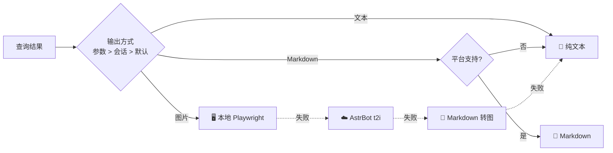
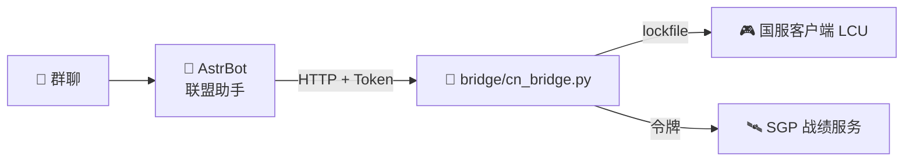

<div align="center">


# 联盟助手

**AstrBot 英雄联盟 / 云顶之弈数据插件**


📊 OP.GG 数据 · 🖼️ 三种推送 · 🇨🇳 国服战绩 · 🔔 主动推送 · 🔌 本地接口

</div>

---

## 🖼️ 效果预览

| 📜 战绩列表 | ⚔️ 单局详情 |
|:---:|:---:|
|  |  |
| **📈 版本梯队** | **♟️ 云顶阵容** |
|  |  |

## ✨ 功能

| | 英雄联盟 | | 云顶之弈 |
|:---:|---|:---:|---|
| 🛡️ | 英雄出装 · 符文 · 加点 · 克制 | ♟️ | 版本阵容 · 站位 · 运营过渡 |
| 🔮 | 海克斯大乱斗强化推荐（棱彩 / 黄金 / 白银） | | |
| 📈 | 分路梯队 · 胜率 / 登场 / 禁用 | 🗡️ | 英雄三件套（登顶率前三） |
| 📜 | 战绩列表（10 人 · 参团 · 标签） | 🎒 | 装备适配英雄 |
| ⚔️ | 单局详情（伤害 / 承伤条 · 出装） | 🔮 | 强化符文搜索 |
| 🏆 | 电竞赛程 · 赛果 · 积分榜（多联赛合并） | | |
| 🎬 | 赛况：每局阵容 · MVP · 资源 · 单局 10 人数据 | | |

## ⌨️ 指令

> 所有查询都可以追加 `-t` / `-m` / `-i`，分别以 文本 / Markdown / 图片 发送。

| 分类 | 指令 | 示例 |
|---|---|---|
| 🛡️ 英雄 | `/lol 英雄 <英雄> [位置] [模式]` | `/lol 英雄 快乐风男 中单` |
| 🔮 海克斯 | `/lol 海克斯 <英雄>` | `/lol 海克斯 亚索` |
| 📈 梯队 | `/lol 梯队 [位置]` | `/lol 梯队 打野` |
| 📜 战绩 | `/lol 战绩 [名字#标签] [大区]` | `/lol 战绩 Hide on bush#KR1 kr` |
| 🏅 资料 | `/lol 资料 [名字#标签] [大区]` | `/lol 资料 @某人` |
| ⚔️ 对局 | `/lol 对局 [序号]` | `/lol 对局 2` |
| 🏆 电竞 | `/lol 赛程 [联赛…]` · `赛果 [联赛…]` · `积分 <联赛>` | `/lol 赛程 S赛 LPL` |
| 🎬 赛况 | `/lol 赛况 [序号\|战队] [局号]` | `/lol 赛况 BLG 2` |
| ♟️ 云顶 | `/tft 阵容 [序号]` · `英雄` · `装备` · `强化` | `/tft 装备 大天使` |
| 🔗 绑定 | `/lol 绑定` · `绑定国服` · `账号` · `切换` · `解绑` | `/lol 绑定国服 名字#12345 艾欧尼亚` |
| 🔔 订阅 | `/lol 订阅 战绩 \| 赛事 [联赛…] \| 梯队 \| 云顶` | `/lol 订阅 赛事 S赛 LPL` |
| ⚙️ 设置 | `/lol 模式` · `大区` · `国服状态` · `状态` · `帮助` | `/lol 模式 图片` |

英雄支持中文名、称号、外号和英文名（亚索 / 疾风剑豪 / 快乐风男 / Yasuo）。

## 🖨️ 推送方式



| 方式 | 适用 | 说明 |
|---|---|---|
| 📝 文本 | 所有平台 | 兜底方式，不会失败 |
| 📄 Markdown | Telegram · Discord · 飞书 · KOOK … | 列表见 `output.markdown_platforms` |
| 🖼️ 图片 | 所有平台 | 图标内嵌，装了 `playwright` 时本地渲染约 3 秒 |

## 🇨🇳 国服接入

OP.GG 不收录国服，需要在**登录国服客户端的电脑**上运行插件自带的代理（参考 League Akari 的 LCU + SGP 方案）。



| 步骤 | 操作 |
|:---:|---|
| 1️⃣ | 运行 `bridge/start_bridge.bat`，首次启动生成 Token |
| 2️⃣ | 插件配置 `cn.bridge_url` / `cn.bridge_token` |
| 3️⃣ | `/lol 国服状态` 检查，`/lol 绑定国服 名字#编号 艾欧尼亚` |

> 💡 大区支持名称、ID 和合并前的旧大区名（祖安 → 联盟一区）。战绩可跨区查询，段位仅限客户端所在大区。

## 🔌 本地接口

启用 `local_api` 后监听 `127.0.0.1:6197`，所有 GET 接口支持 `format=json|text|markdown|html|image`。

| 路径 | 参数 |
|---|---|
| `/api/v1/lol/champion` | `name` `position` `mode` |
| `/api/v1/lol/tier` | `position` |
| `/api/v1/lol/summoner` · `/lol/game` | `riot_id` `region` `count` / `index` |
| `/api/v1/lol/esports` · `/lol/standings` | `mode` `league`（逗号分隔多个） |
| `/api/v1/lol/esports/match` | `index` / `team` / `match_id` · `game` · `league` |
| `/api/v1/tft/meta` · `deck` · `champion` · `item` · `augment` | `limit` / `index` / `name` / `q` |
| `POST /api/v1/push` · `/mcp/call` | 默认关闭 |

```bash
curl -H "Authorization: Bearer TOKEN" "http://127.0.0.1:6197/api/v1/lol/tier?position=mid&format=image" -o tier.jpg
```

## ⚙️ 配置

| 分组 | 常用项 |
|---|---|
| 🌐 `network` | `proxy` 出站代理（国内访问 OP.GG 建议填写） |
| 🖼️ `output` | `default_mode` · `image_renderer` · `image_theme` |
| 🔎 `query` | `default_region` · `match_count` · `match_details` |
| 🇨🇳 `cn` | `bridge_url` · `bridge_token` · `default_server` |
| 🔔 `push` | 检查间隔 · 开赛提醒 · 日报时刻 |
| 🔌 `local_api` | `host` · `port` · `token` |

<details>
<summary>📦 安装与开发</summary>

将仓库放到 `AstrBot/data/plugins/astrbot_plugin_lolhelper` 后在 WebUI 重载。依赖 `aiohttp`、`jinja2`（AstrBot 已自带），可选 `playwright` 加速出图。

```bash
python -m pytest tests            # 离线单元测试
python tests/smoke_live.py out    # 联网生成各视图的 txt / md / html
python tests/astrbot_harness.py w # 在真实 AstrBot 中回归全部指令
```

</details>

<details>
<summary>🗂️ 目录结构</summary>

```
main.py               AstrBot 入口：指令 · LLM 工具 · 消息发送
lolhelper/            核心包（不依赖 AstrBot）
  mcp_client.py dsl.py      OP.GG MCP 客户端与返回格式解析
  service.py tft.py game.py 查询与视图
  cn.py                     国服代理客户端
  render/ doc.py            文本 / Markdown / HTML / 图片渲染
  facade.py push.py api_server.py
templates/card.html   图片模板
bridge/               国服本地代理（零依赖）
```

</details>

## ⚠️ 已知限制

- 🚫 无限火力 / 极限闪击的英雄数据：OP.GG MCP 参数校验问题，暂不可用
- 🚫 云顶个人战绩：OP.GG MCP 未提供接口
- 🛡️ “护盾”标签仅国服数据有

---

<div align="center"><sub>数据来自 OP.GG · Data Dragon · CommunityDragon。本项目与 Riot Games、OP.GG 无关。</sub></div>

